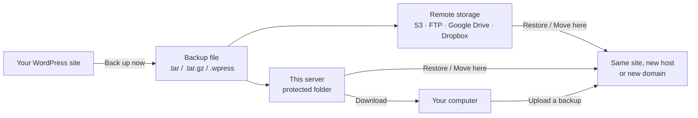
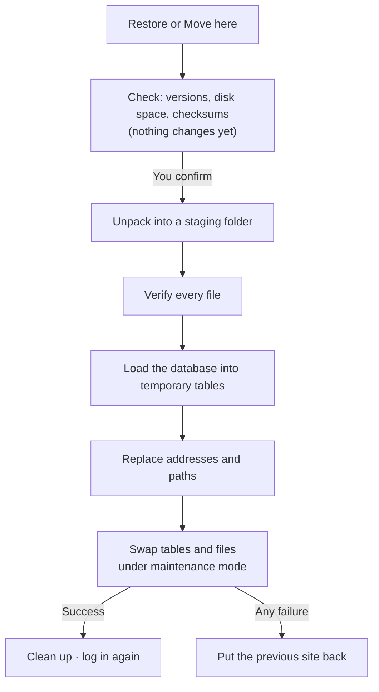
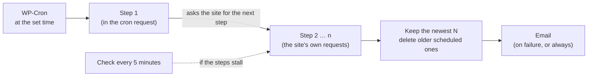
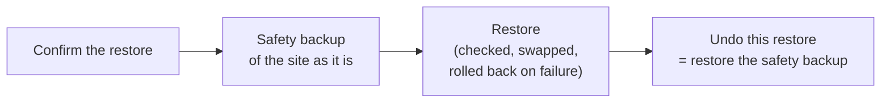
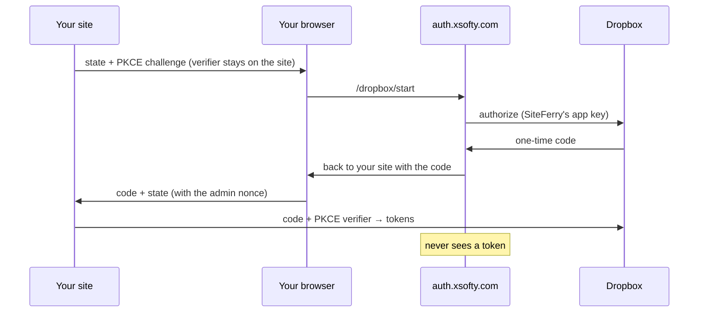

<p align="center">
  
</p>

<h1 align="center">SiteFerry: WordPress backup, restore and migration plugin</h1>

<p align="center">
  <a href="https://www.gnu.org/licenses/gpl-2.0.html"></a>
  
  
  
  <a href="https://xsofty.com/"></a>
</p>

**SiteFerry backs up a whole WordPress site (database, plugins, themes and media) into one file,
restores it, and moves it to a new host or domain.** Send backups to **Amazon S3, Backblaze B2,
Wasabi, Cloudflare R2, DigitalOcean Spaces, any S3-compatible storage, FTP/FTPS, Google Drive or
Dropbox**, and fetch them back. **Schedule** daily, weekly or monthly backups that keep the newest
few and email you if one fails. It also imports and exports **.wpress** backups, so you can move
sites from the All-in-One WP Migration plugin.

Large sites are no problem: every job runs in short, resumable steps, so the PHP time limit,
upload limits and dropped connections don't break a backup or a restore.

> [!NOTE]
> SiteFerry is in active development (0.42.0); see the [roadmap](#roadmap).

## Contents

- [Why SiteFerry](#why-siteferry)
- [Features](#features)
- [How it works](#how-it-works)
- [Install](#install)
- [Back up a WordPress site](#back-up-a-wordpress-site)
- [Scheduled backups](#scheduled-backups)
- [Restore a backup, or move a site to a new host](#restore-a-backup-or-move-a-site-to-a-new-host)
- [Remote storage: S3, FTP, Google Drive and Dropbox](#remote-storage-s3-ftp-google-drive-and-dropbox)
- [Import .wpress backups (All-in-One WP Migration)](#import-wpress-backups-all-in-one-wp-migration)
- [WP-CLI](#wp-cli)
- [Security and privacy](#security-and-privacy)
- [Backup format](#backup-format)
- [Requirements](#requirements)
- [FAQ](#faq)
- [Roadmap](#roadmap)
- [Development and tests](#development-and-tests)
- [License](#license)

## Why SiteFerry

| | SiteFerry |
| --- | --- |
| One-click backup | "Back up now" saves the whole site; Options holds the rest |
| Scheduled backups | Daily, weekly or monthly, to any storage, keeping the newest N, with email on failure |
| Safe restores | Every backup is checked before anything on the site changes; a failed restore puts the old site back |
| Site migration | Moves a site to a new domain or host, rewriting addresses (also inside serialized data) |
| Large sites | Resumable jobs and chunked uploads, no matter how short the PHP time limit is |
| Remote storage | S3-compatible (AWS, B2, Wasabi, R2, Spaces, MinIO), FTP/FTPS, Google Drive, Dropbox |
| Open format | Backups are standard TAR files any archive tool can open, with SHA-256 checksums |
| .wpress | Imports All-in-One WP Migration backups and writes .wpress files it can import |
| No lock-in, no tracking | GPL, no licence keys, no telemetry; it only talks to the storage you set up |

## Features

<details open>
<summary><b>Backups</b></summary>

- One click backs up the database and everything in `wp-content`.
- Leave out media, plugins, themes, inactive plugins and themes, cache folders, spam comments,
  post revisions or single database tables (and any folder, from WP-CLI).
- Optional gzip compression (`.tar.gz`), or a `.wpress` file for All-in-One WP Migration.
- **Space report**: Options shows about how big the backup will be with the choices made, and
  what takes the room (media by year, plugins and themes, the largest files and tables), next to
  the free space on the server.
- **Password protection**: AES-256-GCM encryption of the whole backup (`.enc`), for backups made by
  hand and automatic ones.
- Name, note and tags for each backup; search the list and filter it by tag.
- Download to your computer when it is ready, or send it straight to remote storage (and delete
  the copy on the server if you like).
- One list of every backup, on this server and on every storage, with where each copy is.
- **Scheduled backups**: every day, week or month at a set time; runs on the server without anyone
  logged in, keeps the newest few, and emails you when one fails.
- **Backups before updates**: just before WordPress, a plugin or a theme updates, a quick backup
  of the database and that plugin or theme, so a bad update can be rolled back.

</details>

<details>
<summary><b>Restore and migration</b></summary>

- **Move a site straight to another server** with a one-time key: no download, no upload.
- **Restore** a backup of this site, or **Move here** a backup of another site: the panel says
  which, in plain words, before anything happens.
- The backup is checked first: WordPress, PHP and MySQL versions, free disk space and every
  file's checksum.
- The database loads into temporary tables while the site keeps running; then tables and files
  are swapped under maintenance mode in one step.
- Addresses and folder paths are replaced everywhere (http/https, `www`, JSON, URL-encoded and
  serialized data stays valid).
- If anything fails after the swap starts, the previous site is put back.
- **Safety backup and Undo**: before anything changes, SiteFerry backs up the site as it is; after
  the restore, **Undo this restore** brings it back if it was the wrong backup.
- **Look inside a backup**: browse its folders, download single files, see its database tables.
- **Restore only part of it**: the database, the files, single tables, or one plugin, theme or
  folder of `wp-content`; everything else on the site stays as it is.
- Collations a new database server lacks are mapped to close equivalents.
- SiteFerry itself, its settings and its stored backups stay on the site you restore into.

</details>

<details>
<summary><b>Remote storage</b></summary>

- **S3-compatible**: presets for Amazon S3, Backblaze B2, Wasabi, Cloudflare R2 and DigitalOcean
  Spaces; any other S3 API (MinIO and others) by endpoint. AWS Signature Version 4, no SDK,
  multipart uploads that resume.
- **FTP and FTPS**: explicit FTPS by default, passive mode, uploads in parts that resume.
- **Google Drive**: one-click "Sign in with Google", or your own OAuth client. Only the
  `drive.file` scope: SiteFerry sees only the files it created.
- **Dropbox**: one-click "Sign in with Dropbox", or your own Dropbox app. App folder access only,
  no app secret anywhere (PKCE), and the tokens never leave your site and Dropbox.
- Connection tests that write, read, list and delete a small file.
- **Size limits**: give a storage a largest file size (for example 2 GB, or 4 GB for FAT32 and
  many FTP servers) and larger backups are stored there in numbered parts (`.001`, `.002`, ...),
  shown as one backup and joined again for downloads, checks and restores.
- **Check a stored copy**: SiteFerry downloads it, compares every file with the backup's own
  checksums and deletes the download again. The list shows which copies were checked and how.

</details>

<details>
<summary><b>Admin screen</b></summary>

- Backups, Storage and Activity tabs; works on phones.
- Progress drawn as a route with one leg per step, so you see where a job is.
- Leave the page during a job and resume or cancel it later.
- Every job keeps a log you can read on the Activity tab.

</details>

## How it works



A restore never touches the live site until the backup has been checked and you have confirmed:



## Install

1. Download this repository as a ZIP (**Code → Download ZIP**), or clone it into
   `wp-content/plugins/siteferry`.
2. In WordPress, go to **Plugins → Add New → Upload Plugin**, choose the ZIP, and activate
   **SiteFerry**.
3. Open **SiteFerry** in the admin menu.

<details>
<summary>Make a clean plugin ZIP (without tests and the sign-in relay)</summary>

`.distignore` lists what stays out of the plugin package. With the
[dist-archive command](https://github.com/wp-cli/dist-archive-command) for WP-CLI:

```bash
wp package install wp-cli/dist-archive-command
wp dist-archive . siteferry.zip
```

</details>

## Back up a WordPress site

1. Open **SiteFerry → Backups** and click **Back up now**. That backs up the whole site to this
   server.
2. For more control, click **Options** first: name, note and tags, what to leave out, `.tar` or
   `.wpress`, and where the backup goes. **Back up now** at the end of Options starts it.
3. When it is ready, download it, send it to a storage, or give it a name and tags.

## Scheduled backups

Click **Schedule** on the Backups tab and tick **Back up automatically**:

- **When**: every day, every week (pick the day) or every month (day 1 to 28), at a time in the
  site's time zone.
- **What and where**: the same choices as Options (leave out media, plugins or themes; `.tar`,
  `.tar.gz` or `.wpress`), to this server or a storage, optionally keeping a copy here too.
- **How many to keep**: after a new scheduled backup succeeds, older scheduled backups beyond that
  number are deleted wherever they are stored. Backups you make yourself are never touched.
- **Email**: when a backup fails (default), after every backup, or never.

**Run it now** starts the scheduled backup straight away; you can watch it or leave the page.



> [!TIP]
> WordPress runs scheduled tasks when someone visits the site. On a quiet site, or with
> `DISABLE_WP_CRON`, add a server cron job that runs `wp cron event run --due-now` (or requests
> `wp-cron.php`) every few minutes.

### Backups before updates

Tick **Back up before WordPress, a plugin or a theme updates** in the same panel. Just before an
update starts, SiteFerry backs up the database and the plugin or theme being updated (only the
database for WordPress itself), tagged `before-update`. If an update breaks something, restore
that backup: the database and that plugin or theme go back, and the rest of the site is not
touched. The newest few are kept. If the backup cannot be made within its time allowance, the
update still goes ahead; an update is never blocked.

## Restore a backup, or move a site to a new host

- **Restore** (a backup of this site): click **Restore** on its row. SiteFerry checks it and
  shows what will happen; **Restore now** goes ahead.
- **Move a site here** (from another host or domain): on the old site, make a backup and download
  it, or send it to a storage both sites use. Here, **Upload a backup** (or find it in the list)
  and click **Move here**. SiteFerry shows *From → Into* and changes the addresses to this site's.
- A backup that is only on a storage is downloaded first, in the same flow.
- After a move, log in with the imported site's users.

**Safety backup and Undo.** With **Make a safety backup of this site first** ticked (the
default), SiteFerry backs up the whole site as it is right after you confirm, before anything
changes. Once the restore is done, the Backups tab offers **Undo this restore**, which restores
that safety backup. If the restore fails and the site is left as it was, the safety backup is
removed again; if putting the site back had problems, it is kept.



> [!TIP]
> Different address after the move? Open **Advanced** in the restore panel and enter it.
> Must-use plugins and server-specific drop-ins are only copied if you tick them there.

**Password-protected backups.** Tick **Protect the backup with a password** in Options (or for
automatic backups in the Schedule panel) and enter a password of at least 8 characters. The backup
is encrypted with AES-256-GCM before it is written, so the copy on this server and every copy on a
storage are unreadable without the password; the file name ends in `.enc`. Restoring, checking or
looking inside such a backup asks for the password first, and a wrong one is refused before
anything happens. SiteFerry keeps no password for backups made by hand: without it, the backup
cannot be restored. The password of automatic backups is kept on the site, encrypted with a key
from the WordPress salts, so they can run by themselves; write it down too, because a new server
needs it. Safety backups made before a restore stay on this server and are not encrypted, so
"Undo" never needs a password.

```bash
wp siteferry export --password            # asks for it (or set SITEFERRY_PASSWORD)
wp siteferry import mysite-2026-11-05-1a2b3c4d5e6f.tar.enc --password
wp siteferry backups check mysite-2026-11-05-1a2b3c4d5e6f.tar.enc --password
```
**Multisite networks.** On a network, SiteFerry is used by super admins on the main site, and
backs up the whole network: every site's tables, the network tables and all of `wp-content`
(including each site's media). Such a backup restores into a multisite network of the same kind
(subfolders or subdomains): every subsite keeps its place under the new network's domain and path
(`shop.old.example` becomes `shop.new.example`; a subsite on a domain of its own keeps it), and
subsites made after the backup are removed with their tables. The network address comes from the
new network's `wp-config.php`. Not yet: restoring a single site into a network, a network into a
single site, or only part of a network.
**Move a site straight to another server.** Install SiteFerry on the new site, open **Move** there
and click **Make a key**. On the old site, open **Move**, paste the key and click **Check the
key**: it shows the new site's address, versions and free space. **Move this site there** makes a
backup, encrypted with the key (AES-256, so it is unreadable on the way even over plain http), and
sends it straight to the new site in checked, resumable chunks; nothing passes through your
computer, and the copy on the old server is removed afterwards unless you keep it. On the new site
the backup waits in the list: **Move it here** restores it, without asking for a password, after
the usual check and your confirmation.

The key works once and for 24 hours, opens only the routes that receive the backup, and is dropped
after 20 wrong tries; making a new key ends the old one.

```bash
wp siteferry receive                 # on the new site: prints a key
wp siteferry move SFMOVE1.eyJ1Ijoi... # on the old site
```
**Backups in parts.** A storage with a size limit gets larger backups as numbered parts:
set **Largest file on this storage** in its settings. **Download in parts** in a backup's menu
gives the parts of the copy on this server, for a disk or service with a limit; to put such a
backup back on a site, choose (or drop) all its parts at once in **Upload a backup**: they are
joined in order as they upload. The backup on the server always stays one file.

**Look inside a backup, and restore only part of it.** **Look inside** in a backup's **...** menu
lists its folders and files (with sizes and dates) and its database tables; **Download** gets one
file out of it. Tick what you want back — the whole database or single tables, all files, a
folder of `wp-content` (such as `uploads`), or one plugin or theme — and click **Restore only
these**. The restore panel then says what it restores, checks the backup as usual, and leaves
everything else on the site as it is. **Advanced** in the restore panel also offers **Only the
database** and **Only the files**. A new site address can only be set when the options table is
restored too; a safety backup is still a backup of the whole site.

```bash
# The same from WP-CLI
wp siteferry import mysite-2026-11-05-1a2b3c4d5e6f.tar --paths=plugins/akismet
wp siteferry import mysite-2026-11-05-1a2b3c4d5e6f.tar --tables=wp_posts,wp_postmeta
wp siteferry import mysite-2026-11-05-1a2b3c4d5e6f.tar --only-database
```

## Remote storage: S3, FTP, Google Drive and Dropbox

<details>
<summary><b>Amazon S3, Backblaze B2, Wasabi, Cloudflare R2, DigitalOcean Spaces, MinIO</b></summary>

Choose the provider on the **Storage** tab, enter the bucket, region and keys, and click
**Test connection**. Keys are stored encrypted and never shown again.

A key limited to one bucket and folder only needs this policy on Amazon S3 (replace `BUCKET`; the
default folder is `siteferry`):

```json
{
  "Version": "2012-10-17",
  "Statement": [
    { "Effect": "Allow", "Action": "s3:ListBucket", "Resource": "arn:aws:s3:::BUCKET",
      "Condition": { "StringLike": { "s3:prefix": "siteferry/*" } } },
    { "Effect": "Allow",
      "Action": ["s3:PutObject", "s3:GetObject", "s3:DeleteObject", "s3:AbortMultipartUpload"],
      "Resource": "arn:aws:s3:::BUCKET/siteferry/*" }
  ]
}
```

Add a lifecycle rule that aborts incomplete multipart uploads after a few days, to clean up after
abandoned jobs.

</details>

<details>
<summary><b>FTP and FTPS</b></summary>

Explicit FTPS (TLS) is the default; plain FTP works for servers without TLS, with a warning.
Passive mode by default. Uploads are written in 8 MB parts to `<name>.part` and renamed when
complete. Keep the folder outside the server's public web folder.

PHP's FTP functions encrypt the connection but cannot check the server's certificate. Implicit
FTPS (port 990) and SFTP are not supported.

</details>

<details>
<summary><b>Google Drive</b></summary>

- **Sign in with Google** (default): click the button and allow access. No Google Cloud project
  needed; sign-in and token renewal go through SiteFerry's sign-in service at
  `auth.xsofty.com` (see [Security and privacy](#security-and-privacy)).
- **Your own OAuth client** (advanced): create a "Web application" client in the Google Cloud
  console, register the redirect URI the Storage tab shows, and enter the client ID and secret.

Only the `drive.file` scope is used: SiteFerry can see and change only the files and folders it
created, nothing else in your Drive.

</details>

<details>
<summary><b>Dropbox</b></summary>

- **Sign in with Dropbox** (default): click the button and allow access. Your browser passes
  through SiteFerry's sign-in service at `auth.xsofty.com` on the way to Dropbox and back; the
  access itself goes straight to your site and never through the service.
- **Your own Dropbox app** (advanced): in the Dropbox App Console, create an app with "Scoped
  access" and "App folder"; tick `files.metadata.read`, `files.content.read` and
  `files.content.write`; register the redirect URI the Storage tab shows; enter the app key. No app
  secret is needed.

With "App folder" access SiteFerry sees only its own folder in your Dropbox (Apps → the app's
name). Optionally name a folder inside it, for example one per site. Uploads go in 8 MB parts and
continue after an interruption.



</details>

**Check a copy.** A backup's **...** menu has **Check the copy on this server** and **Check the
copy on** each storage that holds it. The copy is read from start to end without unpacking
anything: every file is compared with the backup's own SHA-256 checksum list, the database dump
must be complete, and anything an import would refuse counts as damage. A copy on a storage is
downloaded into SiteFerry's protected folder first and deleted afterwards; the backups list does
not change. The place badges then show a tick for an intact copy and a warning for a damaged one
(hover for the date and details). A `.wpress` file has no checksums, so for it the check only
makes sure it reads to its end.

```bash
wp siteferry backups check mysite-2026-11-05-1a2b3c4d5e6f.tar
wp siteferry backups check mysite-2026-11-05-1a2b3c4d5e6f.tar --storage=dropbox
```

## Import .wpress backups (All-in-One WP Migration)

SiteFerry reads and writes `.wpress` files, the backup format of the All-in-One WP Migration
plugin, so you can switch plugins without losing your backups:

- **Import**: upload a `.wpress` file and click **Restore** or **Move here**. Every file's CRC-32
  is checked as it is unpacked, and the database dump is converted for SiteFerry's importer
  (prefix, theme and active plugins included).
- **Export**: choose **.wpress file** under Options → File. The result imports with All-in-One WP
  Migration's "Import from file".
- Password-protected `.wpress` backups are recognized but cannot be imported yet.

Tested with All-in-One WP Migration 7.113. SiteFerry is not affiliated with that plugin or its
makers; All-in-One WP Migration is a trademark of its owner.

## WP-CLI

<details>
<summary>All commands</summary>

```bash
# Back up (SiteFerry .tar, compressed, or .wpress)
wp siteferry export [--format=tar|wpress] [--compress] \
  [--exclude=media,plugins,themes,inactive-plugins,inactive-themes,spam-comments,revisions] \
  [--include-cache] [--exclude-tables=...] [--exclude-paths=...] [--dir=...] [--porcelain]

# Back up and send to remote storage
wp siteferry export --send=<id> [--delete-after-send]

# Restore or migrate
wp siteferry import <file> [--replace-url=<url>] [--replace="old=>new;..."] \
  [--include-mu-plugins] [--include-drop-ins] [--force] [--skip-safety-backup] [--yes]

# Restore only part of a backup
wp siteferry import <file> --only-database | --only-files
wp siteferry import <file> [--tables=wp_posts,wp_postmeta] [--paths=uploads,plugins/akismet]

# Backups and storage
wp siteferry backups list [--dir=...] [--format=table|csv|json|yaml]
wp siteferry backups check <name> [--storage=<id>] [--password]
wp siteferry space [--fresh] [--format=table|json]

# Move a site straight to another server
wp siteferry receive [--hours=<n>] [--status] [--cancel]   # on the new site
wp siteferry move <key> [--keep-local]                      # on the old site

# Password-protected backups (asks for it, or set SITEFERRY_PASSWORD)
wp siteferry export --password
wp siteferry import <file>.tar.enc --password
wp siteferry storage test|list <id>
wp siteferry storage send <id> <backup>
wp siteferry storage fetch <id> <name>
wp siteferry storage delete <id> <name> [--yes]

# The backup schedule (set on the Backups tab)
wp siteferry schedule show
wp siteferry schedule run [--quiet]
```

Storage ids: `s3`, `ftp`, `gdrive`, `dropbox`. Settings come from the Storage tab.

`--dir` writes the backup and its work files to another folder, so a site without SiteFerry can be
exported with `wp --require=/path/to/siteferry/siteferry.php siteferry export --dir=...`.

</details>

## Security and privacy

- Administrators only (`manage_options`); every request carries a nonce; Google and Dropbox
  sign-in also use a one-time `state` and PKCE, and tokens are only saved from an authenticated
  request.
- Secret keys, passwords and OAuth tokens are encrypted at rest (libsodium, or OpenSSL AES-256-GCM)
  with a key from the WordPress salts, never shown again, never logged, left out of every backup
  and removed when SiteFerry is deleted.
- Backups live in `wp-content/siteferry-<random>/` with random file names and deny rules; downloads
  go through an authenticated PHP stream.
- Imports refuse links, devices and unsafe paths, accept only the SQL statements a backup
  contains, and load into temporary tables first.
- No licence keys, no update checks of its own, no telemetry. SiteFerry connects only to the
  storage you set up, plus `auth.xsofty.com` for one-click Google and Dropbox sign-in (it holds
  SiteFerry's Google app secret, stores nothing, and backups never pass through it; Dropbox tokens
  don't either).

> [!IMPORTANT]
> On nginx (which ignores `.htaccess`), add a rule such as
> `location ~ /wp-content/siteferry-[a-f0-9]+/ { deny all; }` to block direct access to the
> backup folder as well.

## Backup format

A SiteFerry backup is a plain POSIX TAR file (ustar with pax headers):

| Entry | Contents |
| --- | --- |
| `siteferry.json` | Manifest: site address, versions, options, name, note and tags |
| `database.sql` | The database dump |
| `wp-content/...` | The site's files |
| `siteferry.sha256` | SHA-256 of every file, in `sha256sum` format |

`.tar.gz` backups are a series of independent gzip members of about 8 MB, so an interrupted job
resumes at a member boundary and the file stays a valid gzip archive.

A **password-protected** backup (`.tar.enc` or `.tar.gz.enc`) is that same file, encrypted:

| Part | Contents |
| --- | --- |
| Header (44 bytes) | `SFENC` and version 1, cipher (AES-256-GCM), key derivation (PBKDF2-HMAC-SHA256), its rounds (600,000), a random 16-byte salt, and a 16-byte password check |
| Chunks, to the end | Each: plaintext length, a "final" flag, a random 12-byte nonce, up to 2 MB of ciphertext, a 16-byte tag |

The key comes from the password with PBKDF2 and HKDF. Every chunk is bound to the header, its
number, its length and the final flag, so chunks cannot be changed, reordered, moved to another
backup or cut off without the restore noticing. A wrong password is reported from the header,
before anything is read. Everything inside, including the file names, is encrypted.

## Requirements

| | |
| --- | --- |
| WordPress | 5.8 or later (tested up to 7.1) |
| PHP | 7.4 or later (tested on 7.4, 8.2 and 8.5) |
| PHP extensions | zlib for `.tar.gz`; ftp for FTP storage; sodium or OpenSSL for stored keys; OpenSSL for password-protected backups |
| Database | MySQL or MariaDB |
| Multisite | Whole networks, restored into a network of the same kind |

## FAQ

<details>
<summary><b>How do I migrate a WordPress site to a new host or domain?</b></summary>

Install SiteFerry on both sites. On the old site, click **Back up now** and download the backup (or
send it to a storage both sites can reach). On the new site, click **Upload a backup**, then
**Move here**. SiteFerry checks the backup, shows the old and new addresses, and replaces them
everywhere, including inside serialized data.

</details>

<details>
<summary><b>Can SiteFerry import All-in-One WP Migration (.wpress) backups?</b></summary>

Yes, unless they are protected with a password. Upload the `.wpress` file and click **Restore** or
**Move here**. SiteFerry can also write `.wpress` files for All-in-One WP Migration.

</details>

<details>
<summary><b>Does it work with large sites and low hosting limits?</b></summary>

Yes. Backups, restores and transfers run in short, resumable steps, and uploads go in checksummed
chunks, so PHP time limits, upload size limits and dropped connections don't stop a job. If you
close the page, SiteFerry offers to resume the job next time.

</details>

<details>
<summary><b>What happens if a restore fails?</b></summary>

Nothing changes until the backup is checked and you confirm. If anything fails after the switch
starts, the previous tables and files are put back. And if the restore works but was the wrong
backup, **Undo this restore** brings back the safety backup made just before it.

</details>

<details>
<summary><b>Where are backups stored?</b></summary>

On this server in `wp-content/siteferry-<random>/backups/`, and wherever you send them: S3-compatible
storage, an FTP server, Google Drive or Dropbox. The list on the Backups tab shows every copy.

</details>

<details>
<summary><b>Can SiteFerry back up my site automatically?</b></summary>

Yes. Click **Schedule** on the Backups tab: every day, week or month at a set time, to this server
or a storage, keeping the newest few scheduled backups, with an email when one fails. It runs on
the server by itself; nobody has to be logged in.

</details>

<details>
<summary><b>Is SiteFerry free?</b></summary>

Yes. It is GPL-2.0-or-later software with no licence keys or paid add-ons.

</details>

## Roadmap

- [x] Export and import with resumable jobs (TAR, gzip, SHA-256)
- [x] S3-compatible storage, FTP/FTPS, Google Drive (one-click sign-in)
- [x] .wpress import and export
- [x] Backups home, guided restore, names, notes, tags and search
- [x] Dropbox (one-click sign-in)
- [x] Scheduled backups to your chosen storage, with retention and email
- [x] Safety backup before a restore, with Undo
- [x] A quick backup before WordPress, plugin and theme updates
- [x] Look inside a backup (list and download single files); restore only parts of it
- [x] Check a stored copy (download it and verify its checksums)
- [x] Encrypted backups with a password
- [ ] Importing password-protected .wpress backups
- [x] Space report before a backup
- [x] Backups split into parts, for file size limits
- [ ] More storages: WebDAV (Nextcloud, ownCloud), OneDrive, pCloud
- [x] Site-to-site move without downloading
- [x] Multisite (whole networks)
- [x] Translation-ready (`languages/siteferry.pot`) and prepared for WordPress.org
- [x] A clearer admin page: honest restore texts, remembered backup choices, simpler header, Move
      and Schedule panels, calmer progress and lists

## Development and tests

<details>
<summary>Run the tests</summary>

The stand-alone tests need PHP (7.4, 8.2 and 8.5 are used) and Node; the WordPress tests use
LocalWP test sites. See [`tests/README.md`](tests/README.md) for every test and the browser
checks.

```powershell
# Every CLI test on every PHP build found, plus a PHP 7.4 compatibility scan and the JS test
powershell -ExecutionPolicy Bypass -File tests\run-tests.ps1

# REST API and storage tests on a LocalWP test site
powershell -ExecutionPolicy Bypass -File tests\wp-cli.ps1 siteferry-src eval-file tests/wp/test-rest.php
powershell -ExecutionPolicy Bypass -File tests\wp-storage-check.ps1 -Site siteferry-src
```

The sign-in relay for one-click Google and Dropbox sign-in lives in [`relay/`](relay/README.md).

</details>

## License

SiteFerry is free software under the [GNU General Public License v2.0 or later](https://www.gnu.org/licenses/gpl-2.0.html).

Made by [xsofty](https://xsofty.com/).
