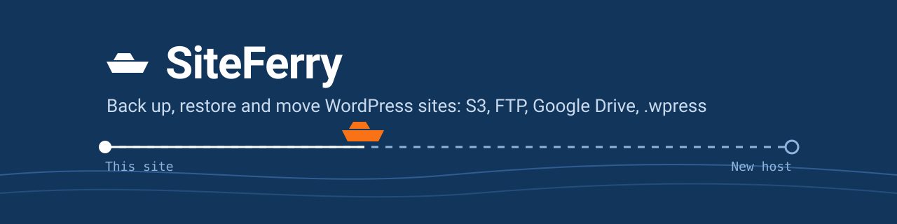
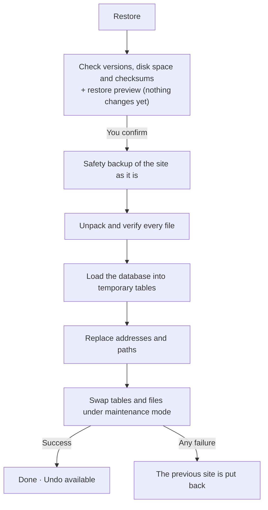

<p align="center">
  
</p>

<h1 align="center">SiteFerry: free WordPress backup, restore and migration plugin</h1>

<p align="center">
  <a href="https://github.com/ihamzarizvi/siteferry/releases/latest"></a>
  <a href="https://www.gnu.org/licenses/gpl-2.0.html"></a>
  
  
  
  <a href="https://xsofty.com/products/siteferry"></a>
</p>

**SiteFerry is a free, open-source WordPress backup plugin.** It backs up your whole site
(database, plugins, themes and media) into one file, restores it safely, and **migrates WordPress
to a new host or domain**. Send backups to **Google Drive, Dropbox, Amazon S3, Backblaze B2,
Wasabi, Cloudflare R2, DigitalOcean Spaces or FTP/FTPS**, schedule **automatic daily, weekly or
monthly backups**, make **incremental (changes-only) backups**, clone your site to a **staging
copy**, and import or export **.wpress** files from All-in-One WP Migration.

No licence keys, no paid add-ons, no tracking. Every job runs in short, resumable steps, so
large sites, low PHP time limits and dropped connections don't break a backup or a restore.

<p align="center">
  <a href="https://github.com/ihamzarizvi/siteferry/releases/latest"><b>⬇ Download the latest plugin ZIP</b></a>
  ·
  <a href="#install">Install</a>
  ·
  <a href="#features">Features</a>
  ·
  <a href="#faq">FAQ</a>
</p>

## Contents

- [Why SiteFerry](#why-siteferry)
- [Features](#features)
- [Install](#install)
- [How to back up a WordPress site](#how-to-back-up-a-wordpress-site)
- [Automatic scheduled backups](#automatic-scheduled-backups)
- [How to restore a WordPress backup](#how-to-restore-a-wordpress-backup)
- [How to migrate WordPress to a new host or domain](#how-to-migrate-wordpress-to-a-new-host-or-domain)
- [Cloud backup storage: Google Drive, Dropbox, S3 and FTP](#cloud-backup-storage-google-drive-dropbox-s3-and-ftp)
- [WordPress staging site](#wordpress-staging-site)
- [WordPress multisite backup](#wordpress-multisite-backup)
- [Import .wpress backups (All-in-One WP Migration)](#import-wpress-backups-all-in-one-wp-migration)
- [WP-CLI and developer hooks](#wp-cli-and-developer-hooks)
- [Security and privacy](#security-and-privacy)
- [Backup format](#backup-format)
- [Requirements](#requirements)
- [FAQ](#faq)
- [Development and tests](#development-and-tests)
- [License](#license)

## Why SiteFerry

| | SiteFerry |
| --- | --- |
| Price | Free and open source (GPL), with no premium version, licence keys or add-ons |
| Cloud backup | Google Drive, Dropbox, Amazon S3 and S3-compatible storage, FTP/FTPS, with one-click sign-in for Google and Dropbox |
| Automatic backups | Daily, weekly or monthly, to several storages at once, with a 3-2-1 backup meter and email alerts |
| Incremental backups | "Changes only" backups after a full one: a few MB instead of hundreds |
| Safe restore | Preview what a restore will change, check every file first, automatic rollback, and Undo afterwards |
| Restore one thing | One file, one post or page, one plugin, theme or table, without touching the rest |
| Migration | Move a site to a new domain or host, rewriting addresses even inside serialized data, or send it straight to the new server |
| Staging | One click copies the site into a subfolder with its own tables, hidden from search engines |
| Emergency kit | A password-protected rescue page that fixes a white screen when wp-admin is down |
| Multisite | Back up whole networks, take one site out, or add a site to a network |
| Open format | Standard TAR files with SHA-256 checksums; also reads and writes .wpress |
| Privacy | No telemetry; it only talks to the storage you set up |

## Features

<details open>
<summary><b>Backups</b></summary>

- **One-click backup** of the database and everything in `wp-content`.
- **Leave out** media, plugins, themes, inactive plugins and themes, cache folders, spam comments,
  post revisions, single database tables or any folder.
- `.tar`, compressed `.tar.gz`, or a `.wpress` file for All-in-One WP Migration.
- **Incremental "changes only" backups**: the whole database plus only the files changed since the
  last full backup. A full backup can't be deleted while changes-only backups need it.
- **Password-protected backups**: AES-256-GCM encryption of the whole file. Copies sent to cloud
  storage can be protected by default, with a "Test my password" box and a monthly reminder.
- **Size and time forecast**: "about 420 MB, about 12 minutes" before you start, including the
  upload time to your storage.
- **Space report**: what takes the room (media by year, plugins, themes, largest files and tables).
- Names, notes and tags; search and filter the list.
- Download to your computer, or send straight to cloud storage.

</details>

<details>
<summary><b>Automatic backups and retention</b></summary>

- **Scheduled backups** every day, week or month at a set time, run by the server with nobody
  logged in.
- **Several storages per schedule**, with a **3-2-1 backup meter**: 3 copies, on 2 kinds of
  storage, 1 off-site.
- **Retention**: keep the newest N, or **keep one backup a day, a week and a month**
  (grandfather-father-son), with a preview of what the next run keeps and deletes.
- **"Make a full backup every N runs"**, with changes-only backups in between.
- **Backups before risky changes**: a quick snapshot before WordPress, a plugin or a theme updates,
  before a plugin or theme is deleted, and before the theme is switched.
- **Weekly check of stored copies**: SiteFerry downloads copies from your storages, verifies every
  checksum and emails you if one is damaged or missing.
- Email when a backup fails, or after every backup.

</details>

<details>
<summary><b>Restore</b></summary>

- **Restore preview**: before you confirm, see which plugins and themes go back to an older or
  newer version, which come back or get turned off, the theme in use, and how the number of posts,
  pages, media, users and comments changes.
- **Every file is checked** against SHA-256 checksums before anything on the site changes.
- The database loads into temporary tables; tables and files are swapped in one step under
  maintenance mode; **any failure puts the old site back**.
- **Safety backup and Undo this restore**.
- **Restore only part of a backup**: the database, the files, single tables, or one plugin, theme
  or folder.
- **Restore one file** from "Look inside", checked against its checksum, with Undo.
- **Restore one post or page** with its custom fields, categories and tags, with Undo.
- **Compare two backups**: plugins, themes, versions, content counts, tables and files, older to
  newer, plus a **backup timeline**.

</details>

<details>
<summary><b>Migration and staging</b></summary>

- **Migrate WordPress to a new domain or host**: addresses and paths are replaced everywhere,
  including JSON, URL-encoded and serialized data.
- **Move a site straight to another server** with a one-time key: no download, no upload; the
  backup travels encrypted.
- **Staging site in one click**: a copy in a subfolder with its own database tables, a STAGING
  badge, no search engine indexing and outgoing email held back. Delete it with one click.
- **.wpress import and export** for moving sites from All-in-One WP Migration.

</details>

<details>
<summary><b>Cloud storage</b></summary>

- **Google Drive**: one-click "Sign in with Google", choose any folder (or a new path such as
  `Backups/My site`); only the `drive.file` permission, so SiteFerry sees only its own files.
- **Dropbox**: one-click sign-in, app folder access only, PKCE with no app secret on your site.
- **Amazon S3 and S3-compatible**: presets for AWS, Backblaze B2, Wasabi, Cloudflare R2 and
  DigitalOcean Spaces; any other S3 API (MinIO and more) by endpoint; resumable multipart uploads.
- **FTP and FTPS**: explicit TLS by default, resumable uploads, fast downloads that reuse one
  transfer.
- **Size limits**: larger backups are stored in numbered parts and joined again automatically.
- **Live connection test** that shows each step, and a "Working / Test failed" badge.

</details>

<details>
<summary><b>Rescue, admin and access</b></summary>

- **Emergency kit**: a single PHP file you download in advance. If the site shows a white screen,
  upload it, sign in with your password, turn off all plugins or switch to a default theme, download
  backups, then restore normally. It never loads WordPress, expires, and can be revoked.
- **Live progress in the admin bar** ("SiteFerry 42%") on every admin page while a job runs.
- **Activity log** with CSV download.
- **Role-based access**: let other roles see backups, make backups, restore, or change settings.
- Works on phones; leave the page during a job and come back later.

</details>

## Install

1. **[Download the latest `siteferry-x.y.z.zip`](https://github.com/ihamzarizvi/siteferry/releases/latest)**
   from Releases.
2. In WordPress, go to **Plugins → Add New Plugin → Upload Plugin**, choose the ZIP, and click
   **Activate**.
3. Open **SiteFerry** in the admin menu and click **Back up now**.

## How to back up a WordPress site

1. Open **SiteFerry → Backups** and click **Back up now**. That backs up the whole site to this
   server.
2. Click **Customize** for more: leave parts out, compress, protect with a password, make a
   changes-only backup, choose `.tar` or `.wpress`, send to a storage. **Save as my settings**
   keeps your choices for next time.
3. When it's ready, download it, send it to a storage, or name and tag it.

```bash
wp siteferry export --exclude=media --compress
wp siteferry export --changes-only --send=gdrive
```

## Automatic scheduled backups

Click **Schedule** on the Backups tab and tick **Back up automatically**: when (daily, weekly or
monthly at a time in your time zone), what to include, which storages to send to, how many to keep
(newest N, or one a day, week and month), how often to make a full backup, and when to email you.
**Run it now** starts it straight away.

The same panel turns on **backups before updates and risky changes** and the **weekly check of
stored copies**.

> [!TIP]
> WordPress runs scheduled tasks when someone visits the site. On a quiet site, or with
> `DISABLE_WP_CRON`, add a server cron job that runs `wp cron event run --due-now` every few
> minutes.

## How to restore a WordPress backup

Click **Restore** on a backup. SiteFerry checks it and shows the **restore preview**: what goes
back, in which version, and what stays. Tick **Make a safety backup first** (on by default) and
click **Restore now**. Afterwards, **Undo this restore** brings the site back if it was the wrong
backup.



**Restore only what you need.** In a backup's menu, **Look inside** lists its folders, files and
tables. Restore one file, one post or page, one plugin or theme, a folder, or single tables, and
everything else stays as it is.

```bash
wp siteferry import mysite-2026-11-05-1a2b3c4d5e6f.tar --paths=plugins/akismet
wp siteferry import mysite-2026-11-05-1a2b3c4d5e6f.tar --tables=wp_posts,wp_postmeta
```

## How to migrate WordPress to a new host or domain

- **With a backup file**: back up the old site and download it (or send it to a storage both sites
  can reach). On the new site, **Upload a backup** and click **Move here**. SiteFerry shows
  *From → Into* and replaces the old address everywhere.
- **Straight from server to server**: on the new site open **Move → Receive** and make a key; on
  the old site open **Move → Send**, paste it, and click **Move this site there**. The backup
  travels encrypted, in checked, resumable chunks, and nothing passes through your computer.

```bash
wp siteferry receive                  # on the new site: prints a one-time key
wp siteferry move SFMOVE1.eyJ1Ijoi...  # on the old site
```

## Cloud backup storage: Google Drive, Dropbox, S3 and FTP

Set up storage on the **Storage** tab. Saving runs a live connection test that shows each step.

| Storage | Sign-in | Notes |
| --- | --- | --- |
| Google Drive | One click, or your own OAuth client | Choose a folder; `drive.file` only |
| Dropbox | One click, or your own app | App folder only; no app secret |
| Amazon S3, B2, Wasabi, R2, Spaces, MinIO | Access keys | Resumable multipart uploads |
| FTP / FTPS | Host and password | Explicit TLS by default |

One-click Google and Dropbox sign-in passes through SiteFerry's sign-in service at
`auth.xsofty.com`, which stores nothing; backups never go through it. See
[Security and privacy](#security-and-privacy).

<details>
<summary>A minimal Amazon S3 policy for one bucket and folder</summary>

```json
{
  "Version": "2012-10-17",
  "Statement": [
    { "Effect": "Allow", "Action": "s3:ListBucket", "Resource": "arn:aws:s3:::BUCKET",
      "Condition": { "StringLike": { "s3:prefix": "siteferry/*" } } },
    { "Effect": "Allow",
      "Action": ["s3:PutObject", "s3:GetObject", "s3:DeleteObject", "s3:AbortMultipartUpload"],
      "Resource": "arn:aws:s3:::BUCKET/siteferry/*" }
  ]
}
```

</details>

## WordPress staging site

Click **Staging** on the Backups tab. SiteFerry copies the site into a subfolder (default
`/staging/`) with its own database tables, so the live site is never touched. The copy shows a
red **STAGING** badge, tells search engines not to index it, holds back outgoing email, and has
no access to your cloud storage. **Delete staging** removes the folder and its tables.

```bash
wp siteferry staging create --folder=staging --no-media
wp siteferry staging delete --yes
```

## WordPress multisite backup

On a network, SiteFerry backs up the **whole network** and restores it into a network of the same
kind (subfolders or subdomains). It can also:

- **Take one site out** of a network backup as a normal single-site backup.
- **Add a single-site backup to a network as a new site**, matching users by email.

```bash
wp siteferry backups extract network-backup.tar --site=2
wp siteferry import single-site.tar --as-new-site=shop
```

## Import .wpress backups (All-in-One WP Migration)

Upload a `.wpress` file and click **Restore** or **Move here**: every file's CRC-32 is checked and
the database is converted for SiteFerry. To go the other way, choose **.wpress file** when backing
up. Password-protected `.wpress` files can't be imported yet. SiteFerry is not affiliated with,
endorsed by or sponsored by ServMask or All-in-One WP Migration, and contains none of its code.

## WP-CLI and developer hooks

Every command supports scripts: lists take `--format=table|csv|json|yaml|count`, actions take
`--porcelain` and `--json`, and the exit code is 0 for success and 1 for an error.

<details>
<summary>Commands</summary>

```bash
wp siteferry export [--archive=tar|wpress] [--compress] [--exclude=...] [--changes-only] [--send=<id>] [--password]
wp siteferry import <file> [--replace-url=<url>] [--paths=...] [--tables=...] [--as-new-site=<name>]
wp siteferry backups list|check|compare|delete|extract|recheck
wp siteferry storage test|list|send|fetch|delete <id> ...
wp siteferry schedule show|run
wp siteferry staging create|status|delete
wp siteferry move <key> · wp siteferry receive
wp siteferry activity [--since=<date>] [--format=csv]
wp siteferry space
```

</details>

Developer hooks include `siteferry_export_started`, `siteferry_export_done`,
`siteferry_import_started`, `siteferry_import_done`, `siteferry_backup_sent`,
`siteferry_job_failed`, and the filters `siteferry_export_exclusions`,
`siteferry_manifest_extra` and `siteferry_backup_name_label`. See [`docs/hooks.md`](docs/hooks.md).

## Security and privacy

- **Permissions:** by default only administrators use SiteFerry. Other roles get only the
  permissions you grant (see, back up, restore, settings). Every request carries a nonce; Google
  and Dropbox sign-in use a one-time `state` and PKCE.
- **Stored secrets:** keys, passwords and OAuth tokens are encrypted at rest with a key from the
  WordPress salts, never shown again, never logged, left out of every backup, and removed when
  SiteFerry is deleted.
- **Backup storage:** backups live in `wp-content/siteferry-<random>/` with random names and deny
  rules, and downloads go through an authenticated stream.
- **Safe imports:** imports refuse links, devices and unsafe paths, accept only the SQL statements
  a backup contains, and load into temporary tables first.
- **No phoning home:** no licence keys, update checks of its own or telemetry. SiteFerry connects
  only to the storage you set up, plus `auth.xsofty.com` for one-click Google and Dropbox sign-in
  ([privacy policy](https://xsofty.com/products/siteferry/privacy-policy),
  [terms](https://xsofty.com/products/siteferry/terms-and-conditions)), and loads Google's folder
  picker only when you choose a Drive folder.

> [!IMPORTANT]
> On nginx (which ignores `.htaccess`), add `location ~ /wp-content/siteferry-[a-f0-9]+/ { deny all; }`
> to block direct access to the backup folder.

## Backup format

A SiteFerry backup is a plain POSIX TAR file that any archive tool can open:

| Entry | Contents |
| --- | --- |
| `siteferry.json` | Manifest: address, versions, options, plugins and themes, content counts |
| `database.sql` | The database dump |
| `wp-content/...` | The site's files |
| `siteferry.sha256` | SHA-256 of every file, in `sha256sum` format |

`.tar.gz` backups are independent gzip members of about 8 MB, so an interrupted job resumes. A
password-protected backup (`.enc`) is that file encrypted with AES-256-GCM in 2 MB chunks, with
the key derived by PBKDF2 (600,000 rounds); file names inside are encrypted too.

## Requirements

| | |
| --- | --- |
| WordPress | 5.8 or later (tested up to 7.1) |
| PHP | 7.4 or later (tested on 7.4, 8.2 and 8.5) |
| PHP extensions | zlib for `.tar.gz`; ftp for FTP storage; sodium or OpenSSL for stored keys; OpenSSL for password-protected backups |
| Database | MySQL or MariaDB |
| Multisite | Whole networks; take one site out or add one in |

## FAQ

<details>
<summary><b>What is the best free WordPress backup plugin with Google Drive?</b></summary>

SiteFerry backs up to Google Drive for free, with one-click sign-in and no Google Cloud project
needed. You can choose any folder, schedule automatic backups and restore from Drive in the same
screen. It only uses the `drive.file` permission, so it can't see the rest of your Drive.

</details>

<details>
<summary><b>How do I migrate a WordPress site to a new host or domain for free?</b></summary>

Install SiteFerry on both sites. Either upload the old site's backup on the new site and click
**Move here**, or use **Move** to send it straight from server to server with a one-time key.
Addresses are replaced everywhere, including serialized data.

</details>

<details>
<summary><b>Can SiteFerry make incremental WordPress backups?</b></summary>

Yes. "Only changes since the last full backup" saves the whole database and only the files that
changed, often a few MB instead of hundreds. A schedule can make a full backup every N runs and
changes-only backups in between.

</details>

<details>
<summary><b>How do I restore one post, page or file from a WordPress backup?</b></summary>

Open **Look inside** in the backup's menu. Restore a single file, or open **Posts and pages** and
restore one post or page with its custom fields and categories. Both come with Undo.

</details>

<details>
<summary><b>How do I create a WordPress staging site?</b></summary>

Click **Staging** on the Backups tab. SiteFerry copies the site into a subfolder with its own
tables, hidden from search engines and with email held back. Delete it with one click when you're
done.

</details>

<details>
<summary><b>What if my WordPress site shows a white screen?</b></summary>

Make an **Emergency kit** in advance. When wp-admin is down, upload the kit file by FTP, sign in
with your password, turn off all plugins or switch to a default theme, and then restore a backup
normally.

</details>

<details>
<summary><b>Can SiteFerry import All-in-One WP Migration (.wpress) backups?</b></summary>

Yes, unless they're protected with a password. Upload the `.wpress` file and click **Restore** or
**Move here**. SiteFerry can also write `.wpress` files.

</details>

<details>
<summary><b>Does it work with large sites and cheap hosting?</b></summary>

Yes. Backups, restores and transfers run in short, resumable steps, and uploads go in checksummed
chunks, so PHP time limits, upload limits and dropped connections don't stop a job.

</details>

<details>
<summary><b>Is SiteFerry really free?</b></summary>

Yes. It's GPL-2.0-or-later software with no licence keys, premium version or paid add-ons, and no
tracking.

</details>

## Development and tests

<details>
<summary>Run the tests</summary>

The stand-alone tests need PHP (7.4, 8.2 and 8.5 are used); the WordPress tests use LocalWP test
sites. See [`tests/README.md`](tests/README.md).

```powershell
powershell -ExecutionPolicy Bypass -File tests\run-tests.ps1
```

The sign-in relay for one-click Google and Dropbox sign-in lives in [`relay/`](relay/README.md).
The full version history is in [`changelog.txt`](changelog.txt).

</details>

## License

SiteFerry is free software under the [GNU General Public License v2.0 or later](https://www.gnu.org/licenses/gpl-2.0.html).

Made by [xsofty](https://xsofty.com/products/siteferry).
